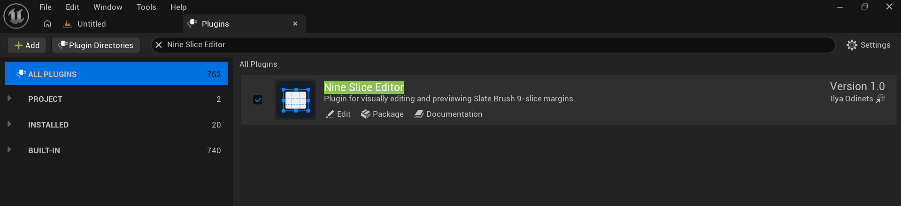
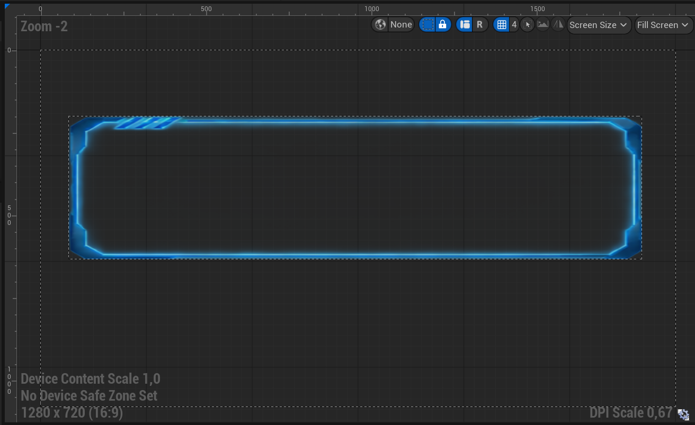
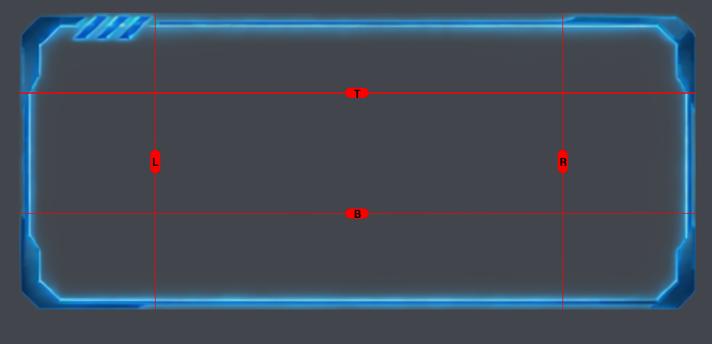
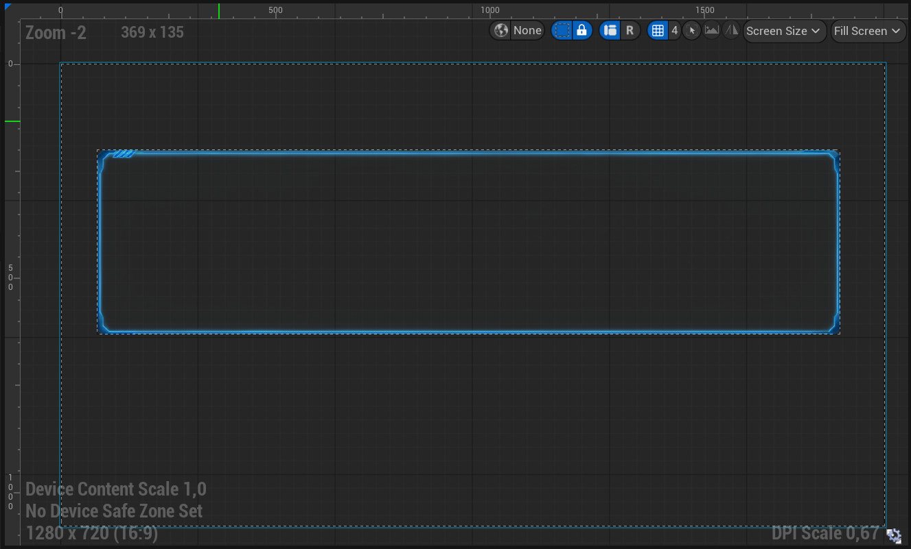
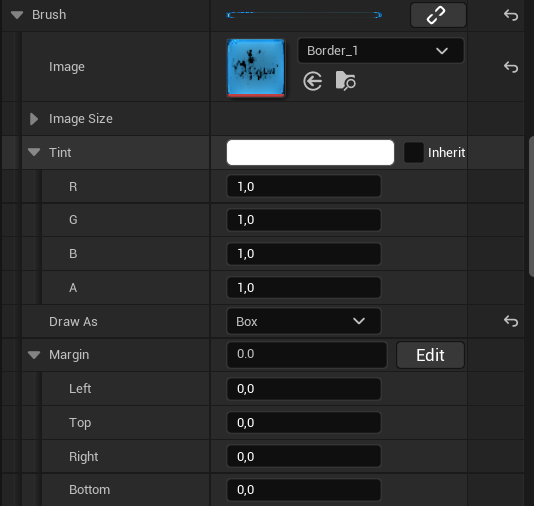
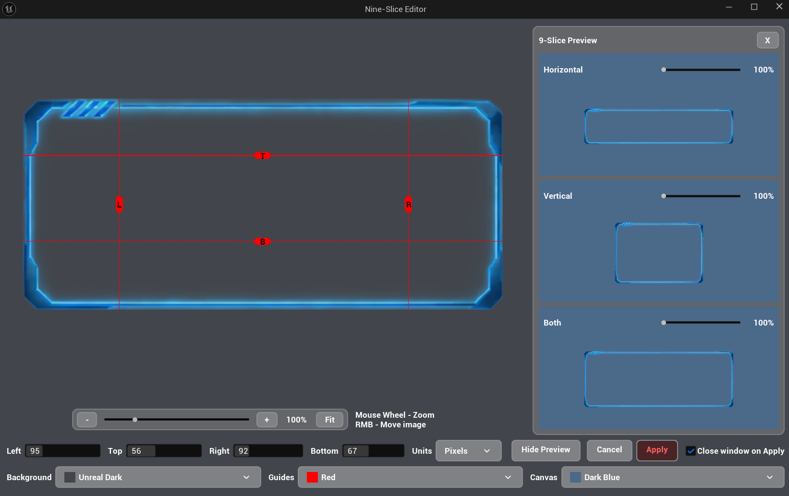

# Nine Slice Editor

Edit and preview 9-slice margins for Slate Brushes directly on the texture in Unreal Engine.

NineSliceEditor adds an **Edit** button next to the `Margin` property of a Slate Brush. Clicking it opens a visual editor where all four margins can be adjusted directly on the texture.

**Available on [Fab](https://www.fab.com/).**

## Using the Plugin

### Enable the Plugin

After installing NineSliceEditor through Fab:

1. Open your project in the corresponding Unreal Engine version.
2. From the main menu, select **Edit → Plugins**.
3. Search for `NineSliceEditor`.
4. Enable the plugin using the checkbox.
5. Restart Unreal Engine if prompted.

Once enabled, find the **Margin** property of a Slate Brush to open the editor. **Draw As** must be set to **Box** or **Border**.

### What Is 9-Slice?

9-slice scaling is a way to resize a texture without distorting its corners. It is commonly used for UI elements such as buttons, panels, windows, and borders, which need to fit different sizes while keeping their original appearance.

Without 9-slice margins, the entire texture stretches when the widget changes size. This can make corners look wider or flatter than intended.

With 9-slice scaling, four margins divide the texture into nine areas:

- **Four corners** keep their original size.
- **Four edges** stretch in one direction.
- **The center** stretches in both directions.

The margins determine where these areas begin and end. The image below shows how the texture is divided.

When the brush is resized, the edges and center adapt to the new dimensions while the corners retain their original size.

In Unreal Engine, these margins are set on the Slate Brush. Adjusting them by entering values in the Details panel can be inconvenient, especially when the correct boundaries are not obvious from the numbers alone.

NineSliceEditor makes this easier by displaying the texture and its margins in a visual editor. Move the guides directly on the image and check the result in the preview.

### Opening the Editor

1. Select an asset or widget that exposes a Slate Brush in the **Details** panel.
2. Find the **Margin** property.
3. Make sure **Draw As** is set to **Box** or **Border**.
4. Click **Edit** next to **Margin**.

The NineSliceEditor window will open with the brush texture and its current margins.

The Margin property is used for the **Box** and **Border** draw modes. Other draw modes do not use these margins in the same way.

### Editing Margins

The editor displays four guides over the texture:

- **Left**
- **Top**
- **Right**
- **Bottom**

Drag a guide with the left mouse button to change the corresponding margin. The guides show the boundaries between the fixed corners, the stretching edges, and the center.

Margin values can be displayed in three units:

- **Pixels** — values based on the texture's pixel dimensions.
- **Normalized** — values expressed relative to the texture dimensions.
- **Percentage** — values expressed as percentages.

Changing the display unit changes how the values are shown, not the position of the margins.

### Mouse Controls

| Input | Action |
| --- | --- |
| LMB + drag a guide | Change the selected margin |
| RMB + drag | Move the texture in the editor |
| Mouse wheel | Zoom in or out |

### Zoom Controls

The editor also includes buttons for controlling the image view:

- **−** — zoom out.
- **+** — zoom in.
- **Fit** — fit the entire texture into the available space.

These controls change the view, not the margin values.

### Color Controls

The editor lets you change the colors of three visual elements:

- **Background** — the editor window background.
- **Guide** — the margin guides and their handles.
- **Canvas** — the background behind the texture in the editing area.

Presets are available for each category. These settings help keep the guides visible against textures with different colors and levels of transparency.

### Preview

The **Preview** panel shows how the current margins behave when the brush is resized.

It contains three examples:

- **Horizontal** — the brush is resized horizontally.
- **Vertical** — the brush is resized vertically.
- **Both** — the brush is resized in both directions.

The preview also has scale controls so you can inspect the result at different sizes.

Use the preview to check that the corners and edges behave as expected before applying the changes.

### Apply and Cancel

When you finish editing, choose one of the following:

- **Apply** — saves the current margins to the brush and closes the editor.
- **Cancel** — closes the editor without applying the changes.

---

## License

NineSliceEditor is free to use and modify, including in commercial projects. Redistribution of the original or modified plugin is permitted only under the terms of the included license.

Selling the plugin itself or offering it as a paid product is prohibited. Projects created using the plugin may be distributed and sold commercially.

See the [LICENSE](https://github.com/DontFWithTheJ/NineSliceEditor/blob/master/LICENSE) file for the full terms.
