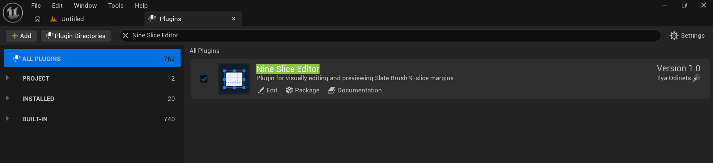
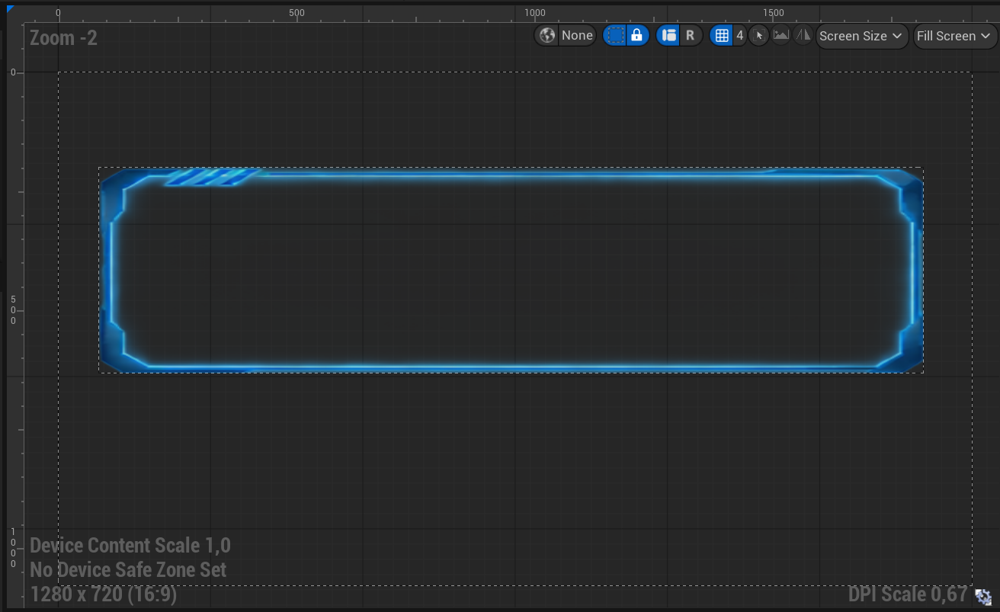
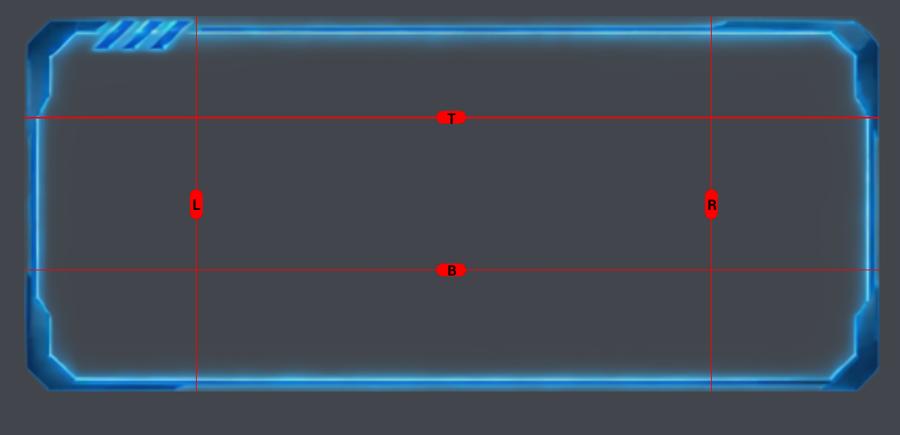
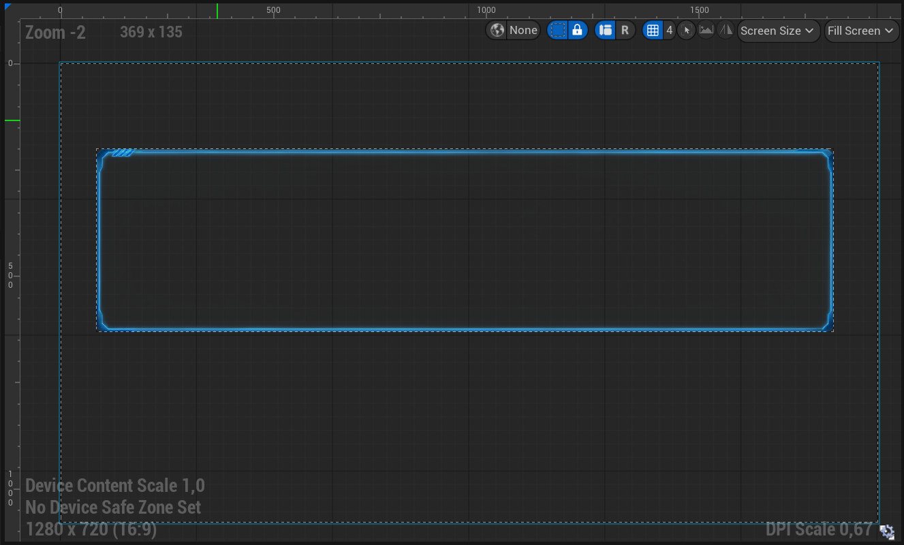
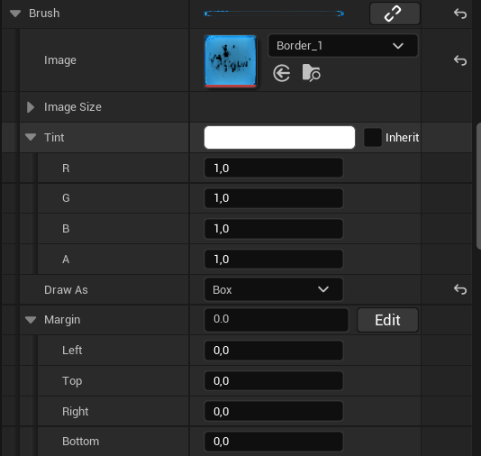
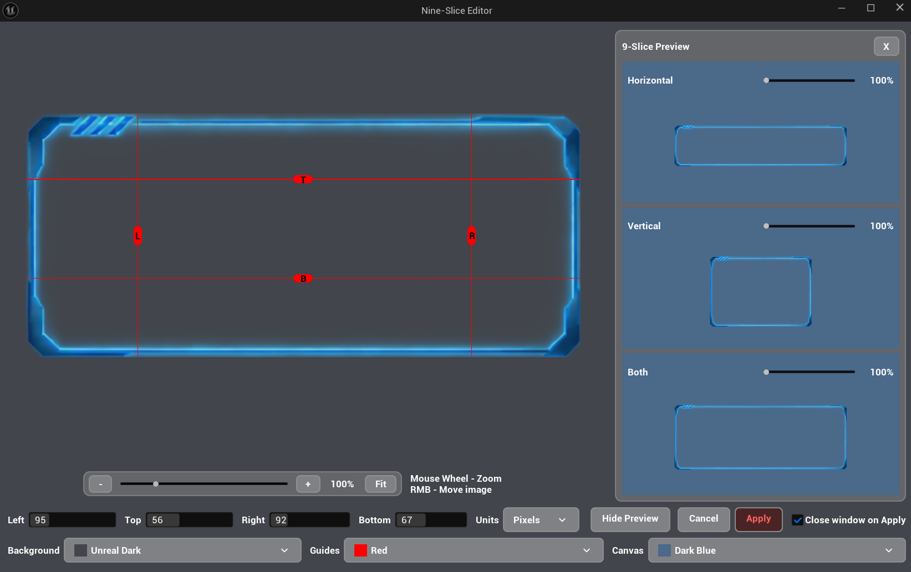

# Nine Slice Editor

Визуальное редактирование и предварительный просмотр полей 9-slice у Slate Brush непосредственно на текстуре в Unreal Engine.

NineSliceEditor добавляет кнопку **Edit** рядом со свойством `Margin` у Slate Brush. При нажатии открывается визуальный редактор, в котором все четыре поля можно настроить непосредственно на текстуре.

**Доступен на [Fab](https://www.fab.com/).**

## Использование плагина

### Включение плагина

После установки NineSliceEditor через Fab:

1. Откройте проект в соответствующей версии Unreal Engine.
2. В главном меню выберите **Edit → Plugins**.
3. Найдите `NineSliceEditor` через поиск.
4. Установите флажок, чтобы включить плагин.
5. Перезапустите Unreal Engine, если редактор предложит это сделать.

После включения перейдите к свойству **Margin** у Slate Brush, чтобы открыть редактор. Для **Draw As** должно быть выбрано значение **Box** или **Border**.

### Что такое 9-slice?

9-slice — это способ изменять размер текстуры без искажения её углов. Этот метод часто используется для элементов интерфейса: кнопок, панелей, окон, рамок и других изображений, которые должны подстраиваться под разные размеры, сохраняя исходный вид углов.

Без полей 9-slice при изменении размера виджета растягивается вся текстура. Из-за этого углы могут стать шире или более плоскими, чем задумано.

При использовании 9-slice четыре поля делят текстуру на девять областей:

- **Четыре угла** сохраняют исходный размер.
- **Четыре края** растягиваются только в одном направлении.
- **Центральная область** растягивается в обоих направлениях.

Поля определяют границы между этими областями. На изображении ниже показано, как разделяется текстура.

При изменении размера Slate Brush края и центральная область подстраиваются под новые размеры, а углы сохраняют исходный размер.

В Unreal Engine эти поля задаются у Slate Brush. Вводить значения вручную через панель Details бывает неудобно, особенно когда нужные границы сложно определить только по числам.

NineSliceEditor упрощает эту задачу: он отображает текстуру и её поля в визуальном редакторе. Перемещайте направляющие непосредственно на изображении и проверяйте результат в области предварительного просмотра.

### Открытие редактора

1. Выберите ресурс или виджет, у которого в панели **Details** доступно свойство Slate Brush.
2. Найдите свойство **Margin**.
3. Убедитесь, что для **Draw As** выбрано значение **Box** или **Border**.
4. Нажмите **Edit** рядом со свойством **Margin**.

Откроется окно NineSliceEditor с текстурой кисти и текущими полями.

Свойство Margin используется в режимах отрисовки **Box** и **Border**. Другие режимы отрисовки не используют эти поля таким же образом.

### Настройка полей

Редактор отображает поверх текстуры четыре направляющие:

- **Left** — левое поле.
- **Top** — верхнее поле.
- **Right** — правое поле.
- **Bottom** — нижнее поле.

Перемещайте направляющую левой кнопкой мыши, чтобы изменить соответствующее поле. Направляющие показывают границы между фиксированными углами, растягиваемыми краями и центральной областью.

Значения полей можно отображать в трёх единицах измерения:

- **Pixels** — значения в пикселях текстуры.
- **Normalized** — значения, нормализованные относительно размеров текстуры.
- **Percentage** — значения в процентах.

Переключение единиц измерения меняет только способ отображения значений, но не положение полей.

### Управление мышью

| Действие | Результат |
| --- | --- |
| ЛКМ + перетаскивание направляющей | Изменить соответствующее поле |
| ПКМ + перетаскивание | Переместить текстуру в редакторе |
| Колесо мыши | Приблизить или отдалить изображение |

### Управление масштабом

В редакторе есть кнопки управления отображением текстуры:

- **−** — уменьшить масштаб.
- **+** — увеличить масштаб.
- **Fit** — вписать всю текстуру в доступную область.

Эти элементы меняют отображение текстуры, но не значения полей.

### Настройка цветов

Можно менять цвета трёх визуальных элементов:

- **Background** — фон окна редактора.
- **Guide** — направляющие и их маркеры.
- **Canvas** — фон под текстурой в области редактирования.

Для каждой категории доступны готовые наборы цветов. Они помогают сохранять хорошую видимость направляющих на текстурах с разными цветами и уровнем прозрачности.

### Предварительный просмотр

Панель **Preview** показывает, как текущие поля ведут себя при изменении размера Slate Brush.

В ней доступны три примера:

- **Horizontal** — изменение ширины.
- **Vertical** — изменение высоты.
- **Both** — изменение ширины и высоты одновременно.

В панели также есть управление масштабом, позволяющее рассматривать результат при разных размерах.

Перед применением изменений проверьте в предварительном просмотре, правильно ли ведут себя углы и края.

### Применение и отмена изменений

После завершения редактирования доступны две кнопки:

- **Apply** — сохраняет текущие поля у Slate Brush и закрывает редактор.
- **Cancel** — закрывает редактор без применения изменений.

## Лицензия

NineSliceEditor можно бесплатно использовать и изменять, в том числе в коммерческих проектах. Распространение оригинальной и изменённых версий плагина допускается только на условиях прилагаемой лицензии.

Запрещено продавать сам плагин или предлагать его в качестве платного продукта. Проекты, созданные с помощью плагина, можно свободно распространять и продавать.

Полные условия приведены в файле [LICENSE](https://github.com/DontFWithTheJ/NineSliceEditor/blob/master/LICENSE).
