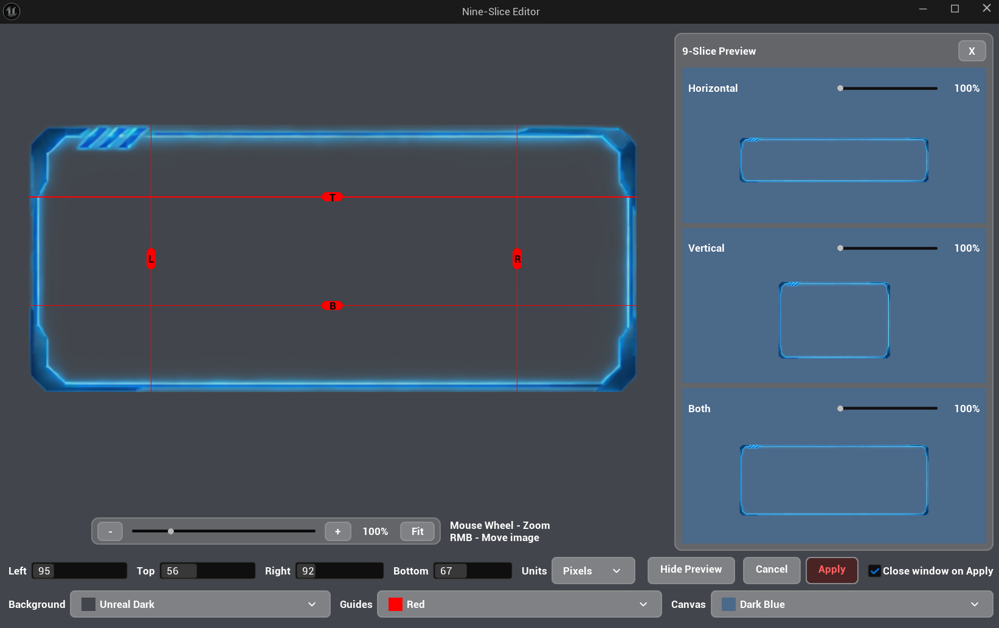
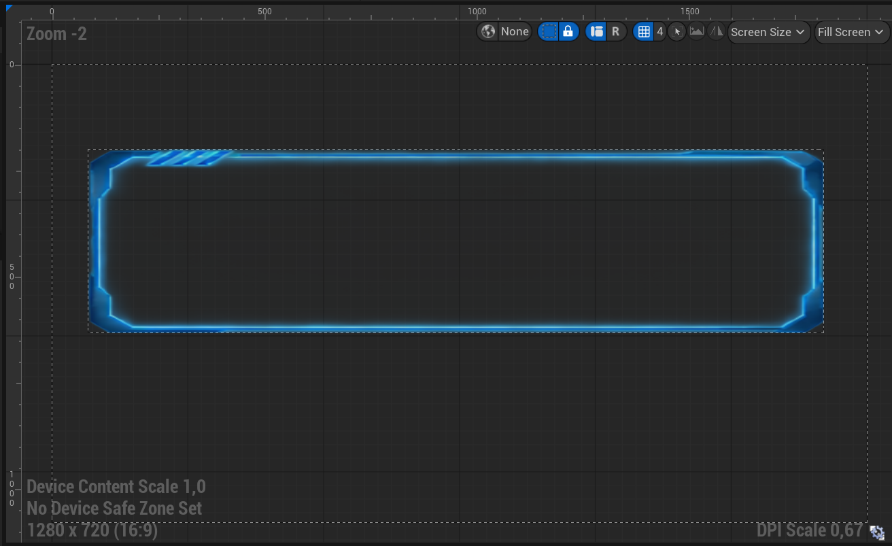
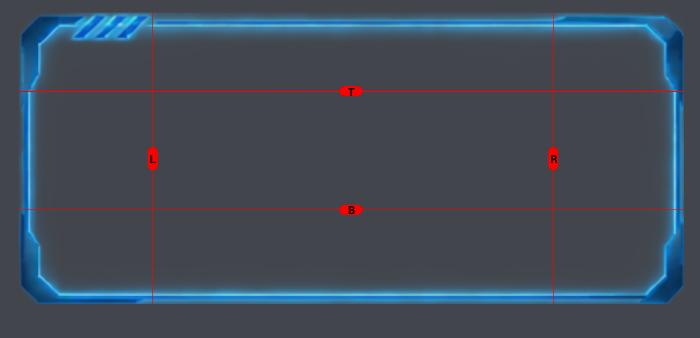
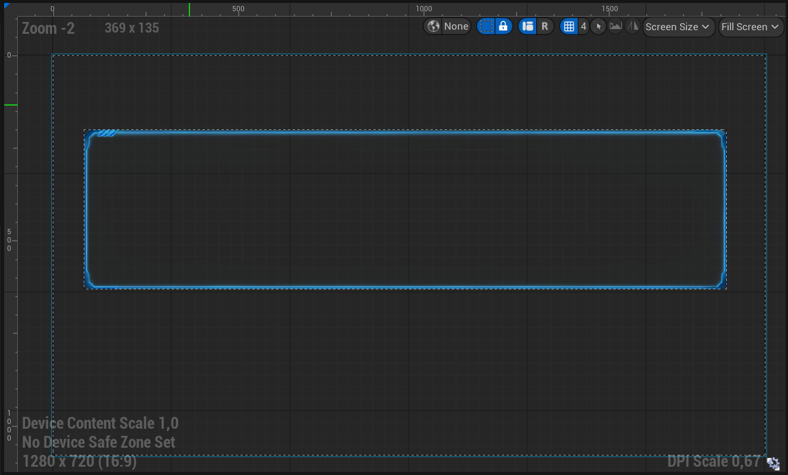
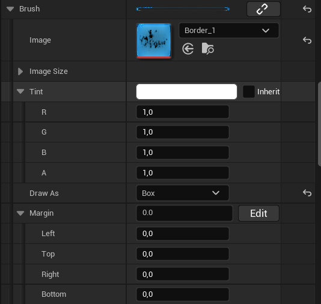
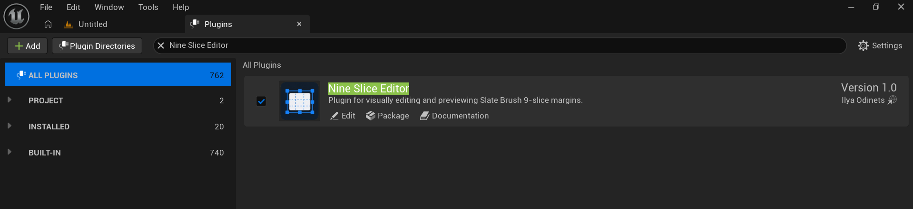

# NineSliceEditor

Визуальное редактирование и предварительный просмотр полей 9-slice у Slate Brush непосредственно на текстуре в Unreal Engine.

NineSliceEditor добавляет кнопку **Edit** рядом со свойством `Margin` у Slate Brush. При нажатии открывается визуальный редактор, в котором все четыре поля можно настроить непосредственно на текстуре.

**Unreal Engine:** 5.7 · [**Репозиторий GitHub**](https://github.com/DontFWithTheJ/NineSliceEditor)



## Содержание

- [Установка](#установка)
- [Использование плагина](#использование-плагина)
- [Сборка из исходников](#сборка-из-исходников)
- [Лицензия](#лицензия)

---

## Что такое 9-slice?

9-slice — это способ изменять размер текстуры без искажения её углов. Этот метод часто используется для элементов интерфейса: кнопок, панелей, окон, рамок и других изображений, которые должны подстраиваться под разные размеры, сохраняя исходный вид углов.

Без полей 9-slice при изменении размера виджета растягивается вся текстура. Из-за этого углы могут стать шире или более плоскими, чем задумано.



При использовании 9-slice четыре поля делят текстуру на девять областей:

- **Четыре угла** сохраняют исходный размер.
- **Четыре края** растягиваются только в одном направлении.
- **Центральная область** растягивается в обоих направлениях.

Поля определяют границы между этими областями. На изображении ниже показано, как разделяется текстура.



При изменении размера Slate Brush края и центральная область подстраиваются под новые размеры, а углы сохраняют исходный размер.



В Unreal Engine эти поля задаются у Slate Brush. Вводить значения вручную через панель Details бывает неудобно, особенно когда нужные границы сложно определить только по числам.

NineSliceEditor упрощает эту задачу: он отображает текстуру и её поля в визуальном редакторе. Перемещайте направляющие непосредственно на изображении и проверяйте результат в области предварительного просмотра.

## Использование плагина

### Открытие редактора

1. Выберите ресурс или виджет, у которого в панели **Details** доступно свойство Slate Brush.
2. Найдите свойство **Margin**.
3. Убедитесь, что для **Draw As** выбрано значение **Box** или **Border**.
4. Нажмите **Edit** рядом со свойством **Margin**.



Откроется окно NineSliceEditor с текстурой кисти и текущими полями.


Свойство Margin используется в режимах отрисовки **Box** и **Border**. Другие режимы отрисовки не используют эти поля таким же образом.

### Настройка полей

Редактор отображает поверх текстуры четыре направляющие:

- **Left** — левое поле.
- **Top** — верхнее поле.
- **Right** — правое поле.
- **Bottom** — нижнее поле.

Перемещайте направляющую левой кнопкой мыши, чтобы изменить соответствующее поле. Направляющие показывают границы между фиксированными углами, растягиваемыми краями и центральной областью.

Значения полей можно отображать в трёх единицах измерения:

- **Pixels** — значения в пикселях текстуры.
- **Normalized** — значения, нормализованные относительно размеров текстуры.
- **Percentage** — значения в процентах.

Переключение единиц измерения меняет только способ отображения значений, но не положение полей.

### Управление мышью

| Действие | Результат |
| --- | --- |
| ЛКМ + перетаскивание направляющей | Изменить соответствующее поле |
| ПКМ + перетаскивание | Переместить текстуру в редакторе |
| Колесо мыши | Приблизить или отдалить изображение |

### Управление масштабом

В редакторе есть кнопки управления отображением текстуры:

- **−** — уменьшить масштаб.
- **+** — увеличить масштаб.
- **Fit** — вписать всю текстуру в доступную область.

Эти элементы меняют отображение текстуры, но не значения полей.

### Настройка цветов

Можно менять цвета трёх визуальных элементов:

- **Background** — фон окна редактора.
- **Guide** — направляющие и их маркеры.
- **Canvas** — фон под текстурой в области редактирования.

Для каждой категории доступны готовые наборы цветов. Они помогают сохранять хорошую видимость направляющих на текстурах с разными цветами и уровнем прозрачности.

### Предварительный просмотр

Панель **Preview** показывает, как текущие поля ведут себя при изменении размера Slate Brush.

В ней доступны три примера:

- **Horizontal** — изменение ширины.
- **Vertical** — изменение высоты.
- **Both** — изменение ширины и высоты одновременно.

В панели также есть управление масштабом, позволяющее рассматривать результат при разных размерах.

Перед применением изменений проверьте в предварительном просмотре, правильно ли ведут себя углы и края.

### Применение и отмена изменений

После завершения редактирования доступны две кнопки:

- **Apply** — сохраняет текущие поля у Slate Brush и закрывает редактор.
- **Cancel** — закрывает редактор без применения изменений.

---

## Установка

### Установка из релиза

Проще всего установить NineSliceEditor из готового релиза.

1. Откройте страницу [Releases](https://github.com/DontFWithTheJ/NineSliceEditor/releases).
2. Скачайте ZIP-архив для вашей версии Unreal Engine.
3. Закройте Unreal Engine, если он запущен.
4. Распакуйте архив.
5. Скопируйте папку плагина `NineSliceEditor` в каталог `Plugins` вашего проекта. Если такого каталога нет, создайте его.

Например:

```text
YourProject/
└── Plugins/
    └── NineSliceEditor/
        ├── NineSliceEditor.uplugin
        └── ...
```

Точное содержимое папки зависит от сборки. Главное, чтобы `NineSliceEditor.uplugin` находился непосредственно внутри папки `NineSliceEditor`, а не внутри дополнительной вложенной папки с таким же названием.

### Включение плагина

После копирования плагина в проект:

1. Откройте проект в Unreal Engine.
2. В верхнем меню выберите **Edit → Plugins**.
3. Найдите `NineSliceEditor` через строку поиска.
4. Установите флажок, чтобы включить плагин.
5. Перезапустите Unreal Engine, если редактор предложит это сделать.



Если плагин не отображается в списке, проверьте расположение файла `.uplugin` и убедитесь, что установленная сборка совместима с вашей версией движка.

### Установка для конкретной версии движка

Плагин также можно установить в каталог плагинов самого движка. В этом случае он будет доступен проектам, использующим соответствующую установку Unreal Engine.

Например, для Unreal Engine 5.7, установленного через Epic Games Launcher в Windows:

```text
C:\Program Files\Epic Games\UE_5.7\Engine\Plugins\Marketplace\NineSliceEditor\
```

Путь может отличаться в зависимости от места установки Unreal Engine.

1. Закройте Unreal Engine.
2. Скопируйте папку `NineSliceEditor` из собранного пакета в каталог плагинов движка.
3. Убедитесь, что `NineSliceEditor.uplugin` находится непосредственно внутри папки `NineSliceEditor`.
4. Запустите проект и при необходимости включите NineSliceEditor через **Edit → Plugins**.

Используйте сборку, подготовленную для той же версии Unreal Engine, в которую устанавливаете плагин. Если у вас только исходный код или нужна сборка для другой версии движка, воспользуйтесь инструкциями в разделе [Сборка из исходников](#сборка-из-исходников).

Такой способ установки распространяется на одну конкретную установку движка. Он не устанавливает плагин автоматически во все версии Unreal Engine на компьютере.

**Какой способ выбрать?**

- **Установка в проект:** подходит, если NineSliceEditor нужен только в одном проекте.
- **Установка в движок:** подходит, если плагин должен быть доступен нескольким проектам, использующим одну установку движка.

### Получение исходного кода

Чтобы получить исходный код плагина, клонируйте репозиторий:

```bash
git clone https://github.com/DontFWithTheJ/NineSliceEditor.git
```

Также можно открыть репозиторий на GitHub, выбрать **Code → Download ZIP** и распаковать архив.

Репозиторий содержит исходный код плагина. Если вы хотите использовать исходники в проекте, изменить их или подготовить сборку для другой версии Unreal Engine, воспользуйтесь подходящим способом сборки ниже.

## Сборка из исходников

Самостоятельная сборка нужна, если вы хотите изменить плагин, отладить его или подготовить пакет для версии Unreal Engine, для которой нет подходящего готового релиза.

Есть два способа сборки. Выбор зависит от того, как вы собираетесь использовать плагин.

### Упаковка через Unreal Automation Tool

Этот способ позволяет собрать плагин отдельно от проекта. Полученный пакет можно установить в проект или в каталог конкретной установки движка.

В Windows откройте командную строку и выполните команду ниже. Замените примеры путей на реальные пути на вашем компьютере.

```bat
"C:\Path\To\UnrealEngine\Engine\Build\BatchFiles\RunUAT.bat" BuildPlugin -Plugin="C:\Path\To\NineSliceEditor\NineSliceEditor.uplugin" -Package="C:\Path\To\Output\NineSliceEditor" -TargetPlatforms=Win64
```

Например, если Unreal Engine 5.7 установлен в `C:\Program Files\Epic Games\UE_5.7`, путь к `RunUAT.bat` будет следующим:

```text
C:\Program Files\Epic Games\UE_5.7\Engine\Build\BatchFiles\RunUAT.bat
```

Аргументы команды:

- `RunUAT.bat` — скрипт Unreal Automation Tool из версии движка, с помощью которой выполняется сборка.
- `-Plugin` — путь к исходному файлу `NineSliceEditor.uplugin`.
- `-Package` — каталог, в который будет помещён собранный плагин.
- `-TargetPlatforms=Win64` — сборка для Windows 64-bit.

В исходной папке плагина должен находиться файл `NineSliceEditor.uplugin`.

После завершения сборки проверьте каталог, указанный в `-Package`. В нём должна находиться собранная версия плагина.

**Для установки в проект** скопируйте папку `NineSliceEditor` из собранного пакета в каталог:

```text
YourProject/Plugins/NineSliceEditor/
```

**Для установки в движок** скопируйте эту же папку в каталог:

```text
<UnrealEngine>/Engine/Plugins/Marketplace/NineSliceEditor/
```

В обоих случаях файл `NineSliceEditor.uplugin` должен находиться непосредственно внутри папки `NineSliceEditor`. Откройте проект и при необходимости включите плагин через **Edit → Plugins**.

Используйте `RunUAT.bat` из той версии Unreal Engine, для которой готовите сборку. Сборка для одной версии движка не гарантирует совместимость с другими версиями.

### Сборка через проект Unreal Engine

Используйте этот способ, если собираетесь работать с исходным C++-кодом плагина непосредственно в проекте Unreal Engine.

1. Закройте Unreal Engine.
2. Скопируйте исходную папку `NineSliceEditor` в каталог `Plugins` вашего проекта.
3. Проверьте, что файл находится по пути `YourProject/Plugins/NineSliceEditor/NineSliceEditor.uplugin`.
4. Сгенерируйте или обновите файлы проекта, если этого требует ваша IDE.
5. Откройте проект в C++ IDE.
6. Соберите цель проекта **Development Editor** для **Win64**.
7. Откройте проект и при необходимости включите NineSliceEditor через **Edit → Plugins**.

Этот способ предназначен для разработки и отладки. Для него требуется настроенная среда сборки C++ для Unreal Engine.

Если плагин не собирается в другой версии Unreal Engine, может потребоваться изменить исходный код: между версиями движка могут меняться API и требования к сборке.

---

## Лицензия

NineSliceEditor можно бесплатно использовать и изменять, в том числе в коммерческих проектах. Распространение оригинальной и изменённых версий плагина допускается только на условиях прилагаемой лицензии.

Запрещено продавать сам плагин или предлагать его в качестве платного продукта. Проекты, созданные с помощью плагина, можно свободно распространять и продавать.

Полные условия приведены в файле [LICENSE](https://github.com/DontFWithTheJ/NineSliceEditor/blob/master/LICENSE).
